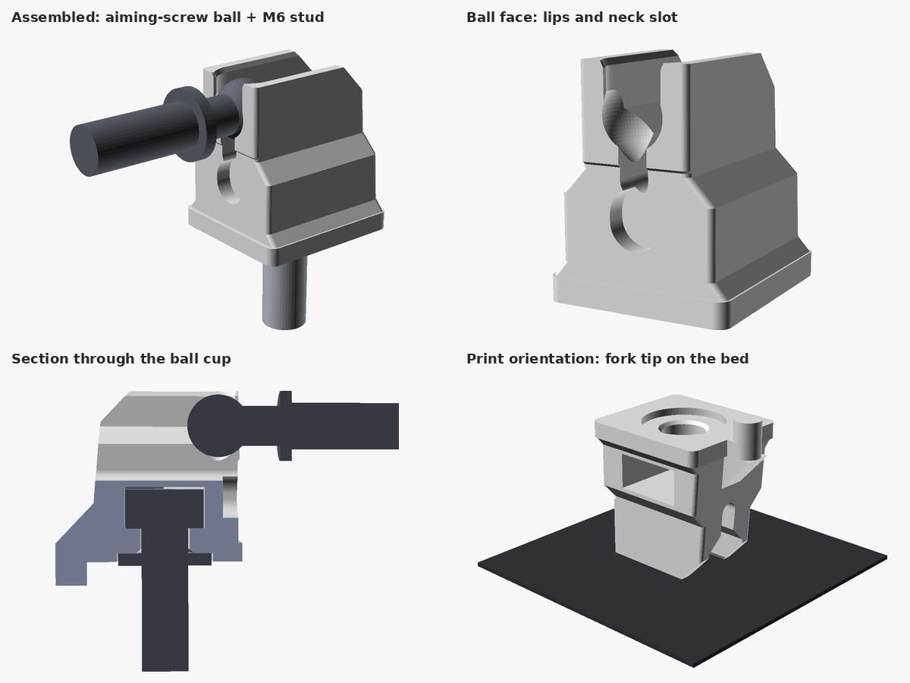

# Toyota Cressida Headlamp Adjuster Bearing (MX73, 1985-88)

A 3D-printable replacement for the plastic **ball socket of the headlamp aiming screw** on the **Toyota Cressida MX73** (US market, model years 1985-1988).
It probably replaces Toyota **81153-22520 "Bearing, Headlamp"** (from parts-catalog research, not confirmed on the car).



> **Status: v6.** Built from caliper measurements of a broken original from a 1985 US Cressida. v5 was printed and assembled: the ball only came out under a firm pull with pliers, and the part did not break. v6 makes the hub stronger and the ball harder to pull out (about +35%, estimated, not measured yet). Fit on other model years has not been checked. Print `cressida_headlamp_bearing_v6_fork_test.stl` first to check the click and hold with your screw.

## How it works
- The part bolts to the back of the headlamp with an M6 stud. A Ø4 mm pin keys it to the lamp bracket so it cannot turn.
- The aiming screw is threaded into the car body and ends in a Ø8 mm ball. The ball snaps into a cup in the fork of this part.
- Turning the screw pushes or pulls the lamp to aim it; the cup lets the ball swivel.

## Features
- Ball cup for the Ø8.0 mm ball: it clicks in from the fork tip (0.6 mm snap). Lips on the ball face (Ø6.0 opening) keep it from coming out, and the neck can swivel about 9°.
- No play along the screw: the channel behind the ball is narrower than the ball.
- Standard M6 hardware, fitted after printing: the nut slides into a side slot whose hex end stops it from turning, and the washer sits in a recess on the plate face. No print pause, no heat-set insert.
- Prints without supports, fork tip on the bed.
- Parametric OpenSCAD source with built-in `assert` checks, plus a fork-only test piece.

## Key dimensions (measured on the original)
- Aiming screw: ball Ø8.0, neck Ø5.1
- Plate: 20 x 18 x 2.4 mm, Ø4 mm pin, M6 x 1.0 stud sticking out 14 mm
- Body: 10.7 mm across the fork
- Overall: 24.0 x 18.0 x 25.1 mm

## Files
| File | Notes |
|---|---|
| `stl/cressida_headlamp_bearing_v6.stl` | The part, already in print orientation (fork tip on the bed) |
| `stl/cressida_headlamp_bearing_v6_fork_test.stl` | Fork end only (15 mm tall), to check the ball click and hold |
| `src/cressida_headlamp_bearing_v6.scad` | Parametric OpenSCAD source (`part = "full" / "fork_test"`) |

To export the STLs again (OpenSCAD 2021.01):
```
openscad -o stl/cressida_headlamp_bearing_v6.stl src/cressida_headlamp_bearing_v6.scad
openscad -D 'part="fork_test"' -o stl/cressida_headlamp_bearing_v6_fork_test.stl src/cressida_headlamp_bearing_v6.scad
```

## Printing
Printed on a Creality Ender-3 V3 SE (0.4 mm nozzle, PEI plate) in PETG, sliced in Creality Print:
- 0.12 mm layers (first layer 0.20 mm), 4 walls, 5 top and 5 bottom layers, 100% infill
- **No supports.** Supports inside the fork are hard to remove and can snap a prong.
- 8 mm outer brim with no gap, because the part stands on its small fork tip. Cut the brim off; do not pry the prongs apart.
- Nozzle 245 °C first layer, 240 °C after; bed 80 °C; fan 30-40%
- About 38 min and 4.5 g per part
- PETG can string inside the nut slot and between the prongs. Dry the filament (65 °C, 4-6 h) and clean up with a knife and tweezers.

**Material:** PETG softens at about 70-80 °C. ASA (about 95-100 °C) is the better choice next to a hot headlamp.

## Hardware
- 1x M6 nut (10 mm across flats, 5 mm thick)
- 1x M6 washer (about Ø12 x 1.6 mm)
- 1x M6 threaded rod, cut to 23.5 mm (or an M6x25 set screw turned in until it stops gently, leaving about 15 mm out)
- Blue threadlocker
- The lamp nut from the old part is reused

## Assembly
1. Slide the nut into the side slot all the way to the end. The hex end stops it from turning.
2. Put threadlocker on the rod. Place the washer in the recess on the plate face, then screw the rod through the washer into the nut until 14 mm sticks out.
3. Fit the ball **from the fork tip**: neck in the slot, push until it clicks. Never push it in from the ball face.
4. Mount the part on the lamp with the old nut: finger-tight plus a quarter turn only.
5. Check the headlamp aim after fitting.

## Tuning
All measured dimensions are parameters at the top of the `.scad` file.
- If the aiming screw binds, set `lip_d = 6.2`: more swivel, less holding force.
- `snap` sets how hard the ball clicks in (fork mouth = `ball_d - snap`).
- Layer lines are weakest where the prongs join the body.

## Version history
- **v6** (current): the hub is solid at the plate, where the load is highest (the inner washer slot is gone). A lip pad in front of the ball shrinks the opening from 6.4 to 6.0 mm, so the ball needs more force to come out.
- **v5**: no print pause. The nut slides into a side slot after printing, and the outer washer sits in a recess.
- **v4**: rebuilt on caliper measurements of the original (Ø8.0 ball).
- **v1-v3**: early versions from photos, superseded and not published.

## License
[CC BY-NC 4.0](https://creativecommons.org/licenses/by-nc/4.0/) - free to share and remix with credit, no commercial use.
Designed by Huthaifa Foudeh.
