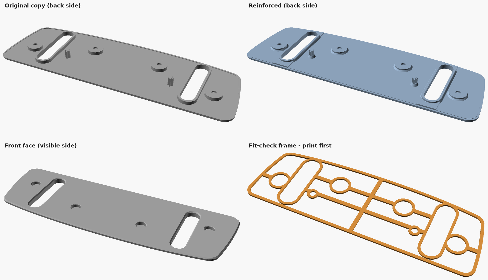
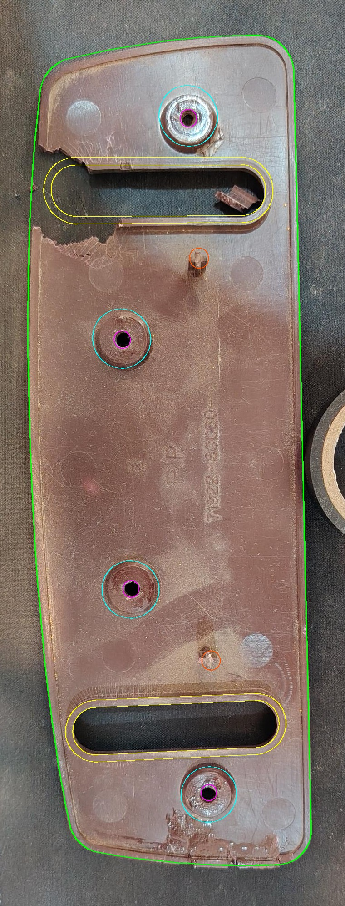

# Toyota Cressida Front Seat Headrest Plate (71922-30060)

A 3D-printable replacement for the brown plastic (PP) plate that holds the headrest on the front seat of the **Toyota Cressida MX73**. Toyota part number **71922-30060** is moulded on the original.



> **Status: revision 2, not printed yet.** The first printed fit-check frame confirmed every screw boss, slot and pin position. It also showed the original sticking out by 0.5-1 mm at the ends and corners, so revision 2 enlarges the outline there. Built from a damaged original from a 1985 US Cressida; fit on other model years has not been checked. Print the fit-check frame first.

## How it was made
The original was broken around one slot. The geometry was reverse-engineered from photos (with a tape measure in the shot) and caliper measurements. The broken top slot was rebuilt as a copy of the intact bottom slot, and the part was treated as mirror-symmetric.



## Files
| File | What it is |
|---|---|
| `stl/cressida_plate_fit_check.stl` | Fit-check frame, revision 2. **Print this first** (about 15-20 min, about 9 g). |
| `stl/cressida_plate_original.stl` | An exact copy of the original's geometry. |
| `stl/cressida_plate_reinforced.stl` | A stronger version with the same contact surfaces (see below). |
| `src/cressida_headrest_plate.scad` | Parametric OpenSCAD source. Choose the version with `variant` = `original`, `reinforced` or `fit_check`. |

To export the STLs again (OpenSCAD 2021.01):
```
openscad -D 'variant="original"'   -o stl/cressida_plate_original.stl   src/cressida_headrest_plate.scad
openscad -D 'variant="reinforced"' -o stl/cressida_plate_reinforced.stl src/cressida_headrest_plate.scad
openscad -D 'variant="fit_check"'  -o stl/cressida_plate_fit_check.stl  src/cressida_headrest_plate.scad
```

## Fit check (do this before the full print)
1. Print `stl/cressida_plate_fit_check.stl`.
2. Lay it on the **back** of the original part.
3. The frame is located by the two outer screw bosses only: one sits in a close-fitting round hole, the other in a close-fitting slot, so the frame cannot slide around. All the other cut-outs are loose and should not touch anything.
4. Look at the outer edge all the way round, especially at the ends and the four corners. Anything of the original that shows outside the frame is a real difference.
5. If a locating boss does not go in (for example because of old glue on its side), change `fc_loc_clr` in the `.scad` file from 0.3 to 0.4 mm and export again.

## Revision 2 (after the first fit check)
The first frame showed the original sticking out slightly at the ends and the corners. Its width at the widest point matched the frame exactly, so filament shrinkage was not the cause. Only the outline changed:
- Each end moved out by 0.3 mm. The overall length is now 236.2 mm.
- The corner fillets are now 9.0 mm on the straight-edge corners and 5.0 mm on the curved-edge corners (they were 10.05 and 6.0), so the corner tips move out by about 0.9 mm and 0.5 mm.
- The straight edge sits 0.3 mm further out near the ends. It is unchanged at the middle, so the width at the middle is still 76.79 mm.
- The screw bosses, slots, pins and all other internal features did not move.

## Printing (PETG, Ender-3 V3 SE)
- **Orientation:** front face down, exactly as exported. The part is 236.2 mm long, so rotate it **45°** on a 220 x 220 bed (footprint about 204 x 204 mm).
- **Layers and walls:** 0.2 mm layers, 4 walls, 5 top and 5 bottom layers, 100% infill. The plate is thin, so it is solid anyway.
- **Temperatures:** about 240 °C nozzle, 75-80 °C bed, 30-50% fan.
- **Supports:** none. Each screw recess has a built-in 0.4 mm bridge layer (`sacrificial_layer`). After printing, push it out with a 4.5 mm drill bit turned by hand or with a small screwdriver.
- **Brim:** none needed on a clean bed. If the corners lift, add a 3 mm brim.

## Screws
The holes are 4.6 mm, for 4 mm self-tapping screws. The recess on the front face is 9.6 mm across and 3.5 mm deep, so a pan or round head up to about 9 mm across sits flush.

## Reinforced version
Everything that touches the seat stays the same: the boss tops, the slot rim tops (z = 5.6 mm), the pins and all positions. The front face and the edge height (2.7 mm) also stay the same.
- The plate is 3.0 mm thick instead of 2.2 mm; the extra material is on the back.
- A solid band 4.0 mm high runs across the plate at each slot, from the slot rim to both edges. This is where the original cracked.
- 45° collars were added at the base of the bosses, slot rims and pins, and the pin tips are chamfered.
- Everything added stays at least 1.6 mm below the contact plane. If something on the seat side presses into the back of the plate, use the original version.

## Measurements used
- **Caliper:** plate 2.2 mm; lip 2.7 mm; slot 58.5 x 13.5 mm with 2.0 mm rim walls, 5.6 mm high; bosses Ø16 x 5.6 mm; hole Ø4.6 mm; recess Ø9.6 x 3.5 mm; cross pins 5 mm with 1.5 mm arms, 10.5 mm high; maximum width 76.79 mm; 73.9-74.0 mm across the far edges of the two middle screw holes.
- **From photos:** the outline and the hole, slot and pin positions.
- **From the first printed fit check:** the outline corrections in revision 2.
- **Estimated from photos:** lip width 1.5 mm. The front edge radius is approximated by a 1.0 mm chamfer.

**Material:** PETG softens at about 70-80 °C. Keep that in mind for a car parked in strong sun.

## License
[CC BY-NC 4.0](../LICENSE) - free to share and remix with credit, no commercial use.
Designed by Huthaifa Foudeh. Part of [Toyota Cressida parts](../README.md).
